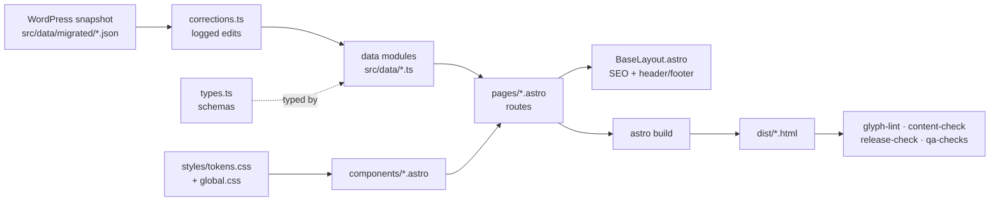

# Contributing to the QualityWorks website prototype

This guide is for anyone picking up the codebase: a developer joining the rebuild, a QA engineer extending the tests, or a content editor adding a case study. Read **README.md** first for what the project is and how to run it. This file explains **how the code is organised, the conventions every file follows, and step-by-step recipes for the most common changes.**

---

## 1. Ground rules

1. **It is a prototype, not production.** Never point it at production DNS, real CRM endpoints or real applicant data. All integrations stay simulated until an owner provides sandbox access (see `docs/13-integrations-platform.md`).
2. **Content is data, not markup.** Words, links, numbers and images live in `src/data/`. Pages and components only *arrange* data. If you are typing marketing copy into a `.astro` file, stop and check whether it belongs in a data module.
3. **One source of truth per thing.**

   | Thing | Single source |
   |---|---|
   | Navigation (header, mobile drawer, footer) | `src/data/navigation.ts` |
   | Global CTAs and company facts | `src/data/site.ts` |
   | Every number, award and certification | `src/data/claims.ts` |
   | Legacy slugs and redirects | `src/data/redirects.json` |
   | Edits to migrated WordPress text | `src/data/corrections.ts` |
   | Design tokens | `src/styles/tokens.css` |

4. **Never invent facts.** No made-up metrics, testimonials, client names, approvals, prices or integrations. Use a clearly labelled fixture (`provenance.source: 'fixture'`) when an interaction needs sample data.
5. **Review tooling must never reach a release.** Anything that exists only for reviewers must be gated with `REVIEW` / `rn()` from `src/lib/release.ts`. Anything blocking a launch must carry a `data-release-blocker` attribute. See §6.
6. **Every change is verified** with `npm run build`, `npm run check:content`, and for behaviour changes `npm run qa:checks` (§7).

---

## 2. Folder map: what lives where and why

```
qualityworks-prototype/
├── astro.config.mjs          Astro settings: static output, trailing slashes, markdown link plugin
├── package.json              npm scripts (build, release gate, QA, content checks, migration)
├── README.md                 What the project is, how to run it, architecture overview
├── CONTRIBUTING.md           This guide: conventions + recipes
├── docs/                     Project documents (audit, design, schemas, SEO, QA, traceability…)
│   └── NN-name.md            Numbered docs are also rendered inside the site at /prototype/NN-name/
├── public/                   Files copied verbatim to the site root (fonts, brand images, media)
├── scripts/                  Node/Python tooling: migration, QA, release gate, scanners
├── qa-output/                Generated QA results and screenshot evidence (committed for traceability)
└── src/
    ├── data/                 ALL content and configuration as typed TypeScript modules
    │   ├── types.ts          The content model (schemas). Start here to understand the data.
    │   ├── migrated/         Raw WordPress snapshots: never edited by hand
    │   └── *.ts / *.json     One module per content type (services, caseStudies, articles, …)
    ├── lib/                  Small framework-free helpers (filters, schema.org, glyphs, release mode)
    ├── styles/               tokens.css (design tokens) + global.css (shared component grammar)
    ├── fonts.css             @font-face rules for the self-hosted brand fonts (Montserrat, Lato)
    ├── layouts/              BaseLayout.astro: <head>, SEO, header, footer, prototype bar
    ├── components/           Reusable UI pieces (cards, buttons, forms, header…)
    │   └── templates/        Page-level templates reused by several routes (ServiceTemplate)
    └── pages/                File-based routes: each .astro file = a URL
```

### How a page is produced (data flow)



---

## 3. Coding conventions

### 3.1 Language and formatting
- **TypeScript** for data and helpers; **`.astro`** for components and pages; **plain CSS** with custom properties (no CSS framework).
- Two-space indentation, single quotes in TS, semicolons. No unused imports.
- Prefer small pure functions. Client-side scripts stay small and dependency-free.

### 3.2 Naming
| Item | Convention | Example |
|---|---|---|
| Component files | PascalCase | `CaseStudyCard.astro` |
| Data modules | camelCase, plural for collections | `caseStudies.ts`, `site.ts` |
| Exported lookups | `thingBySlug` | `serviceBySlug('test-automation')` |
| CSS classes | BEM-ish: `block__element--modifier` | `.card__title`, `.btn--secondary` |
| Design tokens | `--qw-*` brand values, semantic `--color-*`, scales `--fs-*`, `--space-*` | `--qw-teal-700`, `--color-link` |
| Routes | lowercase, hyphenated, trailing slash | `/case-studies/fintech-legacy-platform-modernization/` |
| Correction IDs | `R-NN`, never reused | `R-56` |
| Claim IDs | `CNN`, never reused | `C17` |

### 3.3 Commenting standard (every file follows this)
1. **File header.** Every source file starts with a block comment that answers:
   - **What** this file is (one sentence).
   - **Why** it exists or what decision it implements.
   - **Inputs.** For components: props. For pages: data used. For scripts: arguments.
   - **Used by.** Where it is consumed.
   - **Gotchas.** Anything a newcomer could break.

   In `.astro` files the header goes inside the frontmatter (`---`) as a `/** … */` block.
2. **Props.** Every component `interface Props` field has a short `/** … */` comment.
3. **Inline comments explain *why*, not *what*.** Write `// Hover intent: 200 ms before switching menus so diagonal pointer paths don't swap panels`, not `// set timeout`.
4. **Template comments** inside `.astro` markup use `{/* … */}` (never `<!-- -->`, which is sent to visitors).
5. **CSS.** Comment each logical group and any non-obvious value (contrast ratios, magic numbers).
6. **Review references.** When code exists because of a review finding or requirement, cite it, e.g. `// QM-112 5.5` or `// review round 2 (doc 11)`.
7. Comments must stay true. Update them in the same commit as the code.

### 3.4 Accessibility rules (WCAG 2.2 AA target)
- One `<h1>` per page and no skipped heading levels (QA-01 enforces this).
- Every `` has `alt`: meaningful text, or `alt=""` only if decorative *and* the information is already adjacent.
- Interactive controls are real `<button>` / `<a>` elements with visible focus (`:focus-visible` comes from global.css).
- Never rely on hover alone; menus open on click/Enter too.
- External links open in a new tab and say so to screen readers (the `Button` component does this for you).
- Use only characters the brand font contains (glyph-lint enforces this; use `MetricValue` for “A → B”).

---

## 4. Recipes

### 4.1 Add or edit a service page
1. Open `src/data/services.ts` and copy an existing `Service` record.
2. Set `slug`, `path` (keep the legacy WordPress URL if one exists), `group` (must match a navigation group heading) and `pathway`.
3. Write `cardSummary`, `buyerProblem`, `heroTitle`, `heroLede`, and `capabilities` (≥ 1). Add `process`, `faqs` and `considerations` only with approved or clearly marked proposed copy (`provenance`). FAQ answers with `approval: 'pending-approval'` render on the page but are left out of the FAQPage JSON-LD by `faqLd()` until approved.
   Related slugs (`relatedCaseStudies`, `relatedProducts`, `relatedIndustries`) are checked by `src/data/integrity.ts`; a typo fails the build with the record and field named.
4. Link it in `src/data/navigation.ts` (it will appear in the header, mobile drawer and footer automatically).
5. `src/pages/services/[slug].astro` renders every service whose `path` starts with `/services/`. Other paths need a small page file like `src/pages/maturity-assessments.astro`.
6. `npm run build`, then check the page at 360 px and 1440 px.

### 4.2 Add a case study
Case studies come from the WordPress snapshot plus a curated record:
1. Add (or re-parse) the raw entry in `src/data/migrated/case-studies.wp-snapshot.json` using `scripts/cs.py`.
2. Add a curated entry keyed by its **public slug** in `src/data/caseStudies.ts` (`client`, `industry`, `serviceTags`, `metrics` with `context`).
3. Add alt text in `src/data/altText.ts`.
4. If the WordPress slug must not be public (e.g. it contains a client name), map it in `src/data/redirects.json` → `caseStudySlugRenames`. The redirect rule is generated automatically.
5. Metrics need a source and context. Unapproved client names must use a neutral descriptor.

### 4.3 Correct wording in migrated content (blog posts, case studies)
Never edit `src/data/migrated/*.json`. Add an entry to `src/data/corrections.ts`:
```ts
{ id: 'R-57', target: 'article:{slug}', field: 'bodyHtml', find: 'old wording', replace: 'new wording', reason: 'terminology', note: 'why' },
```
- `target` is `article:{slug}` or `case-study:{public slug}`. `field` is `title`, `excerpt`, `bodyHtml`, `tags`, `customer`, `challenge`, `approach` or `outcome`.
- Spaces in `find` match any whitespace, including the non-breaking spaces WordPress uses.
- **The build fails if `find` no longer matches**, so stale corrections cannot silently stop working.
- Add the correction to the current review-resolution doc (`docs/11-…`, `docs/14-…`) for approval.

### 4.4 Add a number, award or certification
1. Add a `Claim` to `src/data/claims.ts` with `statement`, `context`, `sourceUrl`, `evidence` and `approval`. If the measurement isn't verified, set `verification: 'required-before-launch'`.
2. Display it with `StatBlock` (which refuses stats without a claim) or put `<ClaimRef id="C20" />` next to the text.
3. Release builds automatically drop stats whose verification is still required.

### 4.5 Add a navigation item
Edit `src/data/navigation.ts` only. Use `status: 'proposed'` for anything not in the approved sitemap (QM-41); reviewers then see a gold dot in review mode. QA-14 checks that desktop and mobile show the same destinations.

### 4.6 Add a component
1. Create `src/components/MyThing.astro` with the file header (§3.3) and a documented `interface Props`.
2. Style it with tokens (`var(--space-4)`, `var(--color-text)`), never raw hex values, and support the dark surfaces (`.surface-dark`, `.surface-product`) through semantic tokens.
3. Add it to the inventory table in `src/pages/design-system/index.astro`, with a live example if it's visual.

### 4.7 Add a fixture (sample data for an interaction)
Set `provenance: { source: 'fixture', approval: 'fixture' }`, prefix titles with `[Fixture]` where shown, and render a `FixtureLabel`. Release builds must filter fixtures out (see how `events.ts` and `articles.ts` use `RELEASE`).

### 4.8 Add a page
Create `src/pages/my-page/index.astro`, wrap the content in `BaseLayout` with a unique `seo.title` and `seo.description`, use `PageHero` for the top of the page, and pass `breadcrumbs`. Add the route to the README route table and, if it should appear in menus, to `navigation.ts`.

### 4.9 Add a QA check
Add a block to `scripts/qa-checks.mjs` using `rec(id, requirement, area, expected, pass, actual, evidence, issue)`. Map the new ID to its QM-112 requirement in `QM112` inside `scripts/qa-report.mjs`. A check that cannot run (missing access) records `pass = null`, which reports **Blocked**, never Pass.

---

### 4.10 Add a people photograph to a page header
1. Use a photo QualityWorks has the right to publish (the live site's images or approved team photography). Never use AI-generated people, and never describe stock subjects as staff or clients.
2. Export WebP files at 800 and 1600px wide (plus 2400px for a full-width hero) to `public/people/{id}-{width}.webp`.
3. Add a record to `src/data/peopleImagery.ts`: `alt` (what is visible, neutral), `focus` (CSS object-position that keeps faces in frame), `sourceUrl` and `licence`.
4. Pass it to the header: `<PageHero image={peopleImage('id')} … />`, or set `heroImage` on an industry record. Check the crop at 390, 820 and 1440px.
5. One photo per header. Do not add photos to body sections as decoration (doc 15 §4 lists the pages deliberately left without one).

### 4.11 Colours and fonts
Colours and fonts come from the *QualityWorks Brand Guidelines v1.0* and are defined only in `src/styles/tokens.css`. Use semantic tokens (`--color-link`, `--color-eyebrow`, `--color-primary`) or brand primitives (`--qw-teal-500`), never hex values. Headings, buttons, navigation, labels and eyebrows inherit Montserrat (`--font-display`); everything else inherits Lato (`--font-body`). Name a new title or label element with a BEM `__title`, `__heading` or `__label` suffix and it picks up the display face automatically. Before using a brand colour for small text, check its contrast (doc 02 §4): Teal and Green fail as text on white, so use `--qw-teal-700` there. The brand gradient (`.brand-rule`) appears once per page only.

## 5. Data model cheat sheet
The full schemas are in `src/data/types.ts` and the reasoning is in `docs/04-content-schemas.md`. Every record carries **`provenance`**:

| `source` | Meaning |
|---|---|
| `wordpress-migrated` | From the live WordPress site |
| `live-site-copy` | Copied from a live page and structured by hand |
| `external-platform` | Owned by another system (BambooHR, marketplace, QualityWatcher) |
| `structured-code` | Maintained in this repo |
| `proposed-copy` | New wording awaiting approval |
| `fixture` | Fictional; must never be released |

`approval` is one of `published-live` · `pending-approval` · `approved` · `fixture` · `not-verified`. Nothing is `approved` yet; approval comes from Janique, not from code.

---

## 6. Review mode vs release mode
`src/lib/release.ts` exports `RELEASE`, `REVIEW` and `rn(note)`.

| Build | Command | What happens |
|---|---|---|
| Review (default) | `npm run build` | Everything visible for reviewers; pages `noindex` |
| Release candidate | `npm run build:release` | `QW_RELEASE=true`; review UI removed; `/prototype/` and `/design-system/` deleted; `scripts/release-check.mjs` fails on any leftover marker or `data-release-blocker` |

When you add review-only UI, wrap it in `{REVIEW && …}` or use `data-review-note={rn('…')}`. When you add a placeholder that must be replaced before launch, add `data-release-blocker={RELEASE ? 'reason' : undefined}`. The release gate is **expected to fail** today; the blockers are listed in `docs/12-release-cleanup.md`.

---

## 7. Verification workflow (run before every commit)
```bash
npm run build            # builds, writes _redirects, runs glyph-lint (fails on fallback-font characters)
npm run check:content    # prohibited terms, unsupported figures, client names: text, attributes, JSON-LD, source
npx astro preview --port 4321 &
npm run qa:checks        # 37 browser checks + regenerates docs/07-qa-testing-summary.md
npm run build:release    # release gate (fails by design until blockers are resolved)
```
Rules: never mark something **Pass** that was only simulated, and never report a phrase as absent unless `check:content` scanned every channel (text, attributes, JSON-LD, source).

---

## 8. Commits
- Small, focused commits with an imperative subject (`Rename fintech case study slug`).
- Reference the review round or requirement in the body (`Review round 2, finding 1`, `QM-112 4.4`).
- Regenerated artefacts (`qa-output/`, `docs/07…`) go in the same commit as the change that produced them.

## 9. Glossary
| Term | Meaning |
|---|---|
| QM-112 | Software Requirements Specification for the rebuild (v0.5) |
| QM-113 | This prototype task |
| QM-41 | Approved sitemap (Jira; not yet accessible to this project) |
| QM-103 | Hosting research |
| Claim | Any number/award/certification shown on the site (`claims.ts`) |
| Correction | A logged edit to migrated content (`corrections.ts`) |
| Fixture | Fictional sample data used only to demonstrate an interaction |
| Release blocker | Placeholder that must be resolved before launch (`data-release-blocker`) |
| Review mode | Default build with prototype bar, annotations and the Review hub |
