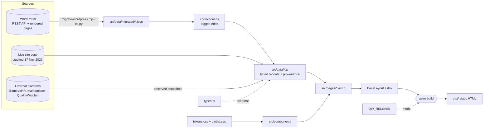

# QualityWorks corporate website: QM-113 prototype

A clickable, code-first prototype of the rebuilt **qualityworkscg.com**, built for Janique's review and as a reference implementation for the developers who will build the production site.

> **Status: non-production prototype.** No production deployment is authorised (QM-112 AC-HND-01, QM-103 §6).
> - The default build is a **review build**: every page is `noindex`, the contact form *simulates* submission and sends nothing, fictional records are labelled “Fixture”, and the review tools are on.
> - A separate **release build** removes the review tools and runs a release gate. That gate is **designed to fail** until the open items in `docs/12-release-cleanup.md` are resolved.

**New here?** Read this README top to bottom (about 15 minutes), then [CONTRIBUTING.md](CONTRIBUTING.md) for conventions and step-by-step recipes.

---

## Contents
1. [What this project is](#1-what-this-project-is)
2. [Quick start](#2-quick-start)
3. [Repository, branch and handoff](#3-repository-branch-and-handoff)
4. [Technology stack](#4-technology-stack)
5. [Project structure (every folder and key file)](#5-project-structure)
6. [Architecture and data flow](#6-architecture-and-data-flow)
7. [Build pipeline](#7-build-pipeline)
8. [npm scripts reference](#8-npm-scripts-reference)
9. [Configuration and environment variables](#9-configuration-and-environment-variables)
10. [Routes](#10-routes)
11. [Content model](#11-content-model)
12. [Design system](#12-design-system)
13. [Component catalogue](#13-component-catalogue)
14. [Review mode vs release mode](#14-review-mode-vs-release-mode)
15. [Quality checks and QA evidence](#15-quality-checks-and-qa-evidence)
16. [Content migration and corrections](#16-content-migration-and-corrections)
17. [Redirects](#17-redirects)
18. [Integrations status](#18-integrations-status)
19. [Documentation index](#19-documentation-index)
20. [Troubleshooting](#20-troubleshooting)
21. [Known limitations and open decisions](#21-known-limitations-and-open-decisions)

---

## 1. What this project is

| Item | Detail |
|---|---|
| Purpose | Show the proposed design system, navigation, page templates, buyer journeys and interactions for the QualityWorks website rebuild, and give developers a working reference |
| Requirements | QM-112 *Software Requirements Specification* v0.5 (traceability in `docs/08-traceability.md`) |
| Task | QM-113 (prototype). The approved sitemap QM-41 is in Jira and was not accessible to this project |
| Audience | Janique (review), developers (handoff), QA (test evidence), marketing (content decisions) |
| What it is *not* | Not a production site. Not connected to HubSpot, BambooHR, analytics or a CMS. No real form submissions |
| Review history | Round 1 corrections: `docs/11-review-resolution.md`. Round 2: `docs/14-review-round-2.md`. Visual revision: `docs/15-visual-revision.md` |

The **review build** (`npm run build`) has **102 pages**. The **release output** (`npm run build:release`) keeps 80 HTML pages, because it drops the review-only routes (`/prototype/*`, `/design-system/`) and event records marked `fixture` or `not-verified`. The review build contains:
- the homepage, solutions (services) and engagement models;
- 3 product pages and a products overview;
- 10 industry/audience pages and 17 case studies;
- the resources hub, blog with 12 migrated articles, and events;
- about, careers and contact;
- review-only pages: the Review hub with 15 documents, a claims register, and a design-system page.

---

## 2. Quick start

### Prerequisites
- **Node.js 20 or newer** (built and tested on Node 22.23).
- npm 10+.
- Optional, for QA: Playwright with Chromium installed on the machine (`require('playwright')` must work). The QA scripts do not install it.
- Optional, for the audit helpers: Python 3 with `beautifulsoup4`.

### Run it
```bash
git clone https://github.com/itsdebrakayes/qualityworks-website-prototype
cd qualityworks-website-prototype
npm install
npm run dev          # http://localhost:4321  (live reload while you edit)
```

### Build and preview the static site
```bash
npm run build        # REVIEW build into dist/ (+ _redirects + glyph lint)
npm run preview      # serves dist/ at http://localhost:4321
```

### Run all checks
```bash
npm run build
npm run check:content                 # prohibited terms, unsupported figures, client names
npx astro preview --port 4321 &       # QA needs the preview server running
npm run qa:checks                     # 37 browser checks; regenerates docs/07-qa-testing-summary.md
npm run build:release                 # release gate (fails by design until blockers are resolved)
```

Start reviewing at **`/prototype/`** (the Review hub). Toggle **“Review annotations”** in the yellow bar to see claim IDs, proposed navigation items and provenance outlines.

---

## 3. Repository, branch and handoff

| Item | Status |
|---|---|
| Repository | **https://github.com/itsdebrakayes/qualityworks-website-prototype** (private; personal account of the prototype author) |
| Branch | `main`, with full commit history |
| Review copy | Private Claude Artifact built from `dist/` with relative links (link held by the project owner) |
| Corporate repository | **Not yet established.** No QualityWorks organisation repository has been created or confirmed |
| Hosting | **None.** QM-103 shortlists Netlify / Cloudflare Pages for a static build; nothing is approved |

**Moving to a company repository later:**
1. The technical lead creates an empty repository in the QualityWorks GitHub organisation (QM-103 §2.1).
2. Transfer this repository (*Settings → Transfer ownership*), or push it: `git remote add company <url>` then `git push company main`.
3. Protect `main`, require pull-request review, and add CI running `npm ci && npm run build && npm run check:content` (and `npm run qa:checks` against a preview server).
4. Connect a **preview** host from the QM-103 shortlist. Do **not** connect production DNS.

---

## 4. Technology stack

| Layer | Choice | Why |
|---|---|---|
| Framework | **Astro 5.18.2**, `output: 'static'` | Pre-rendered HTML, near-zero JavaScript, framework-neutral components; no framework had been approved, so this is an assumption (AS-3) |
| Language | TypeScript (data, helpers), `.astro` (components/pages), plain CSS | Typed content model, no CSS framework lock-in |
| Client JavaScript | About 10 KB of small modules (menus, filters, contact form, careers/agents toggles) | Pages read fine without JS; only interactions need it |
| Content storage | TypeScript modules in `src/data/` + raw WordPress JSON snapshots | CMS-agnostic schemas that map 1:1 to a future CMS |
| Fonts | Montserrat (display) + Lato (body), self-hosted woff2 (SIL OFL) | Specified by the QualityWorks Brand Guidelines v1.0; no third-party font requests |
| Runtime dependency | `astro` | |
| Dev dependency | `axe-core@4.10` | Accessibility checks inside the QA script |
| Machine tools (not in package.json) | Playwright + Chromium; ImageMagick (`convert`) for `fetch-media.sh`; Python 3 + BeautifulSoup for audit helpers | |

---

## 5. Project structure

```
qualityworks-prototype/
├── README.md                    ← you are here
├── CONTRIBUTING.md              conventions, commenting standard, recipes for common changes
├── astro.config.mjs             static output, trailing slashes (WordPress-compatible), markdown external-link plugin
├── package.json                 npm scripts (see §8)
├── tsconfig.json                extends astro/tsconfigs/strict
├── docs/                        project documents 01–14 (also rendered at /prototype/NN-name/)
│   └── _manual-qa.md            manual inspection log merged into doc 07 by qa-report.mjs
├── public/                      copied verbatim to the site root
│   ├── fonts/                   self-hosted Montserrat and Lato woff2 files
│   ├── people/                  header photographs (WebP, from the live site; see src/data/peopleImagery.ts)
│   ├── brand/                   logo, Clutch badges, CEO portrait (from the live site)
│   └── media/                   resized featured images for articles and case studies
├── qa-output/                   generated QA evidence (results.json, perf-local.json, evidence/*.png)
├── handoff/                     (git-ignored) zip exports for sharing
├── scripts/                     tooling (see §15 and §16)
│   ├── migrate-wordpress.mjs    WordPress REST API → src/data/migrated/articles.wp-snapshot.json
│   ├── fetch-media.sh           mirrors and resizes featured images into public/media/
│   ├── cs.py / extract.py / text.py   audit helpers used to parse the live site
│   ├── gen-redirects.mjs        writes <outDir>/_redirects from src/data/redirects.json
│   ├── glyph-lint.mjs           fails the build if a character would render in a fallback font
│   ├── content-check.mjs        prohibited terms / unsupported figures / client names (text, attributes, JSON-LD, source)
│   ├── release-check.mjs        release gate for dist-release/
│   ├── qa-checks.mjs            Playwright + axe browser QA (37 checks)
│   ├── qa-report.mjs            turns qa-output/results.json into docs/07-qa-testing-summary.md
│   └── perf-local.mjs           local LCP/CLS/transfer smoke test
└── src/
    ├── data/                    ALL content and configuration
    │   ├── types.ts             the content model: every schema, documented field by field
    │   ├── site.ts              company facts, offices, social links, global CTAs
    │   ├── navigation.ts        header mega-menu, mobile drawer and footer (single source)
    │   ├── services.ts          services, engagement models, programmes + homepage pathways
    │   ├── products.ts          products, QualityWatcher tools, agent catalogue snapshot
    │   ├── industries.ts        industries and audience pages (public sector, SMB)
    │   ├── caseStudies.ts       case studies = WordPress snapshot + curated taxonomy/metrics
    │   ├── articles.ts          blog/news (WordPress snapshot) + fixtures
    │   ├── events.ts            events + phase logic (upcoming / past / cancelled / date TBC)
    │   ├── jobs.ts              BambooHR observation + fixture vacancies
    │   ├── team.ts              leadership (CEO only; others pending)
    │   ├── testimonials.ts      verbatim testimonials from the live homepage
    │   ├── claims.ts            claims register: every number/award/certification
    │   ├── corrections.ts       logged edits applied to migrated content at build time
    │   ├── altText.ts           written alt text for case-study and article images
    │   ├── redirects.json       legacy slug → public slug renames (only home of legacy slugs)
    │   ├── integrity.ts         build-time cross-reference check (unknown related slugs fail the build)
    │   ├── peopleImagery.ts     header photographs: source URL, alt text, crop focus, licence status
    │   └── migrated/            raw WordPress snapshots (never edited by hand)
    ├── lib/
    │   ├── release.ts           RELEASE / REVIEW flags and rn() helper
    │   ├── glyphs.ts            glyph, heading and link normalisation for migrated HTML
    │   ├── filters.ts           client-side filter controller (URL state, live count, empty state)
    │   ├── schema.ts            schema.org JSON-LD builders
    │   ├── media.ts             maps WordPress media URLs to local copies
    │   └── docs.ts              loads docs/NN-*.md for the in-site Review hub
    ├── styles/
    │   ├── tokens.css           design tokens (colour, type, space, radius, shadow, motion, surfaces)
    │   └── global.css           base styles + shared grammar (buttons, cards, badges, forms, prose)
    ├── fonts.css                @font-face rules for the self-hosted fonts
    ├── layouts/BaseLayout.astro <head> SEO + JSON-LD, skip link, prototype bar, header, footer
    ├── components/              28 reusable components (see §13)
    │   └── templates/ServiceTemplate.astro   shared service/engagement/assessment page
    └── pages/                   file-based routes (see §10)
```

---

## 6. Architecture and data flow



**Key ideas**
- **Content is data.** Pages and components never hard-code marketing copy. They render records from `src/data/`. Swapping in a CMS later means replacing the data modules with API calls that return the same shapes.
- **Every record has provenance**: where it came from and its approval state. It is visible to reviewers when Review annotations are on.
- **Migrated text is never edited in place.** `corrections.ts` applies logged, reviewable edits at build time, and fails the build if one stops matching.
- **Review tooling is a build mode**, not a separate code path. `src/lib/release.ts` decides what renders.

---

## 7. Build pipeline

`npm run build` runs these steps, and stops at the first failure:

| Step | Tool | What it does | Fails when |
|---|---|---|---|
| 1 | `astro build` | Renders every route from the data modules into `dist/` | Type/template error, a **correction no longer matches** its source text, or `src/data/integrity.ts` finds a record pointing at an **unknown slug** |
| 2 | `scripts/gen-redirects.mjs dist` | Writes `dist/_redirects` (18 rules) | Output folder missing |
| 3 | `scripts/glyph-lint.mjs` | Checks every visible character is in the brand font's character set | A character would render in a fallback font |

`npm run build:release` runs the same steps with `QW_RELEASE=true` into `dist-release/`, then `scripts/release-check.mjs` (see §14).

---

## 8. npm scripts reference

| Script | Command | Use it when |
|---|---|---|
| `dev` | `astro dev` | Editing with live reload |
| `build` | astro build + redirects + glyph lint | Before every commit |
| `preview` | `astro preview` | Viewing the built site |
| `build:release` | release build + release gate | Checking launch readiness (expected to fail today) |
| `check:content` | `node scripts/content-check.mjs` | After any copy change; must report 0 marketing and 0 source hits |
| `qa:checks` | QA suite + report | After behaviour/layout changes (needs preview running) |
| `migrate:wordpress` | `node scripts/migrate-wordpress.mjs` | Refreshing the article snapshot (needs network) |

Other scripts are run directly: `./scripts/fetch-media.sh`, `node scripts/perf-local.mjs`, `node scripts/qa-report.mjs`, `python3 -I scripts/cs.py …`.

---

## 9. Configuration and environment variables

| Setting | Where | Default | Effect |
|---|---|---|---|
| `QW_RELEASE` | env var | unset (review mode) | `true` switches to release mode (§14) |
| `QA_BASE` | env var | `http://localhost:4321` | Base URL for `qa-checks.mjs` and `perf-local.mjs` |
| `WP_PER_PAGE` | env var | `12` | Number of posts `migrate-wordpress.mjs` fetches |
| `site`, `trailingSlash: 'always'`, `build.format: 'directory'` | `astro.config.mjs` | — | URLs end in `/` like WordPress |
| Markdown external-link plugin | `astro.config.mjs` | — | Links in `docs/*.md` open safely in a new tab |
| Canonical origin | `src/data/site.ts` → `legacyOrigin` | `https://qualityworkscg.com` | Canonical and Open Graph URLs |

No secrets are needed or stored. Never add credentials to the repository.

---

## 10. Routes

| Route | File | Data | Notes |
|---|---|---|---|
| `/` | `pages/index.astro` | services pathways, products, case studies, articles, events, claims | Homepage |
| `/services/` | `pages/services/index.astro` | `services.ts`, `navigation.ts` | “Solutions” overview |
| `/services/{slug}/` | `pages/services/[slug].astro` → `ServiceTemplate` | `services.ts` | 16 service pages |
| `/engagement-models/`, `/engagement-models/{slug}/` | `pages/engagement-models/*` | `services.ts` (kind `engagement-model`) | |
| `/maturity-assessments/`, `/innovation-tourism/` | single-file pages → `ServiceTemplate` | `services.ts` | Legacy root URLs kept |
| `/products/` | `pages/products/index.astro` | `products.ts` | Proposed route |
| `/qualitywatcher-ai-tools/` | `pages/qualitywatcher-ai-tools/index.astro` | `products.ts` (`qwTools`) | “QualityWatcher AI” |
| `/products/agents-as-a-service/` | `pages/products/agents-as-a-service.astro` | `products.ts` (`agentSnapshot`) | Proposed route |
| `/products/prism/` | `pages/products/prism.astro` | `products.ts`, claims | Proposed; content blocked on owner |
| `/industries/`, `/industries/{slug}/` | `pages/industries/*` | `industries.ts` | Includes proposed public-sector and SMB pages |
| `/case-studies/`, `/case-studies/{slug}/` | `pages/case-studies/*` | `caseStudies.ts` | Legacy `/case-study/{slug}/` → 301 pending (§17) |
| `/resources/` | `pages/resources/index.astro` | `articles.ts`, `events.ts` | Proposed hub |
| `/blog/`, `/{post-slug}/` | `pages/blog/index.astro`, `pages/[slug].astro` | `articles.ts` | Root-level slugs preserved from WordPress |
| `/events/`, `/events/{slug}/` | `pages/events/*` | `events.ts` | Proposed route |
| `/about-us/`, `/careers/`, `/contact-us/` | `pages/*/index.astro` | `site.ts`, `team.ts`, `jobs.ts`, testimonials | |
| `/privacy-policy/`, `/terms-conditions/` | `LegalStub` | — | Text not reproduced (links to live) |
| `/thank-you/`, `404` | | | `noindex` |
| `/prototype/`, `/prototype/{doc}/`, `/prototype/claims/` | `pages/prototype/*` | `docs/*.md`, `claims.ts` | **Review only**: removed from release builds |
| `/design-system/` | `pages/design-system/index.astro` | `tokens.css`, components | **Review only** |

---

## 11. Content model
The full field-by-field documentation is in `src/data/types.ts`, and the rationale is in `docs/04-content-schemas.md`.

| Type | Module | Count | Source of truth (production) |
|---|---|---|---|
| `Service` | `services.ts` | 21 | CMS |
| `Product`, `QwTool`, `AgentRecord` | `products.ts` | 5 / 4 / 8 | CMS; marketplace API for agents |
| `Industry` | `industries.ts` | 10 | CMS |
| `CaseStudy` | `caseStudies.ts` | 17 | CMS (with client-disclosure approval flag) |
| `Article` | `articles.ts` | 12 (+1 fixture) | CMS / WordPress |
| `EventRecord` | `events.ts` | 3 real + 2 fixtures | CMS |
| `Job` | `jobs.ts` | 0 live (BambooHR) + 3 fixtures | BambooHR |
| `Person` | `team.ts` | 1 | CMS |
| `Claim` | `claims.ts` | 19 | Repo (governance) |
| `Correction` | `corrections.ts` | 45 | Repo (governance) |

**Provenance values:** `wordpress-migrated`, `live-site-copy`, `external-platform`, `structured-code`, `proposed-copy`, `fixture`. **Approval values:** `published-live`, `pending-approval`, `approved` (none yet), `fixture`, `not-verified`.

---

## 12. Design system
- **Tokens** (`src/styles/tokens.css`), rendered live at `/design-system/`:
  - colour (Brand Guidelines v1.0): Green `#2CAF81`, Teal `#29A59A`, Blue `#289DAD`, Mint `#ECF7F6`, the slate canvas `#1A212B`–`#424D5B`, plus derived teal-700 `#1D766F` for small text on light (5.42:1);
  - fonts: `--font-display` (Montserrat) and `--font-body` (Lato), defined once;
  - fluid type scale aligned to the guide (D1 44, D2 30, heading 22, eyebrow 13, body 17);
  - 4 px spacing scale;
  - radii, shadows and motion (all disabled under reduced motion).
- **Surfaces:** `.surface-dark`, `.surface-product`, `.surface-tint` and `.surface-alt` remap the semantic tokens (`--color-text`, `--color-link`…), so components work on any background.
- **Shared grammar** (`src/styles/global.css`): buttons (one pill style, three variants, two sizes), card shell, badges, checklists, forms, prose for migrated articles, and focus rings.
- **Typography:** Montserrat for headings, buttons, navigation, labels and eyebrows; Lato for paragraph copy and captions; system monospace for code (doc 15 §3).
- **People imagery:** `PageHero` takes an `image` prop (`peopleImage('id')`); the homepage hero has its own full-width photo layout. Photos and their licence status live in `src/data/peopleImagery.ts` (doc 15 §1).
- Rationale and contrast table: `docs/02-design-direction.md`; visual revision change log: `docs/15-visual-revision.md`.

---

## 13. Component catalogue

| Component | Purpose | Key props |
|---|---|---|
| `Header` | Mega-menu (hover intent, keyboard) + modal mobile drawer, from `navigation.ts` | `currentPath` |
| `Footer` | Company info + link columns derived from `navigation.ts` | — |
| `ProtoBar` | Yellow prototype bar: Review hub link + annotations toggle (review mode only) | — |
| `PageHero` | Inner-page hero (light / dark / product variants) | `title`, `lede`, `variant`, `breadcrumbs`, `primary`, `secondary` |
| `SectionHeading` | Eyebrow + heading + optional subheading + lede | `eyebrow`, `title`, `subheading`, `lede`, `level` |
| `Button` | The one button/link style; marks external hand-offs | `cta` or `href`+`label`, `variant`, `size` |
| `ServiceCard` / `ProductCard` / `CaseStudyCard` / `ArticleCard` / `EventCard` | Content cards with a single clickable link | the record (`service`, `p`, `cs`, `a`, `e`) |
| `StatBlock` | Statistics; refuses a stat without a registered claim; drops unverified claims in release | `stats`, `footnote` |
| `ClaimRef` | Review-mode claim ID annotation | `id` |
| `ProofBlock` | Verbatim testimonials | `ids` |
| `FaqAccordion` | Native `<details>` FAQ | `items` |
| `FilterBar` | Labelled select filters (+ `lib/filters.ts`) | `filters`, `id` |
| `EmptyState` / `Skeleton` / `Alert` | Empty, loading and feedback states | `title` / `count` / `tone`, `title` |
| `ContactForm` | Live field set, validation, simulated loading/success/error | `idPrefix` |
| `CtaBand` | Closing conversion section | `title`, `primary`, `secondary` |
| `Breadcrumbs` | Visible trail (JSON-LD comes from BaseLayout) | `items` |
| `ProcessSteps` | Numbered delivery approach | `steps` |
| `Wireframe` | Placeholder naming the content decision; a release blocker | `title`, `decision`, `owner` |
| `FixtureLabel` | Always-visible label on fictional content | `text` |
| `MetricValue` | Renders “A → B” with an SVG arrow (the arrow glyph isn't in the brand font) | `value` |
| `Icon` | Inline SVG icon set | `name`, `label` |
| `LegalStub` | Placeholder for legal pages | `title`, `path` |
| `templates/ServiceTemplate` | Full service/engagement page | `service` |

Every component file starts with a header describing its purpose, props, usage, accessibility and gotchas.

---

## 14. Review mode vs release mode

| | Review build (`npm run build`) | Release build (`npm run build:release`) |
|---|---|---|
| Prototype bar, Review hub, annotations | Shown | Removed (`/prototype/`, `/design-system/` deleted) |
| Claim IDs, `data-review-note` outlines | Shown | Not rendered |
| Fixtures (jobs, events, PRISM whitepaper) | Shown, labelled | Excluded |
| Simulation controls | Shown | Removed; the contact form shows an error, never a fake success |
| Unverified statistics (C02–C04) | Shown with a qualification | Dropped |
| Events without verified dates | Shown as “Date to be confirmed” | Excluded |
| Robots | `noindex, nofollow` | Production directive |
| Gate | — | `release-check.mjs` fails on any leftover marker or `data-release-blocker` |

Current gate result and the blocker list: `docs/12-release-cleanup.md`.

---

## 15. Quality checks and QA evidence

| Check | Script | Covers |
|---|---|---|
| Glyph lint | `glyph-lint.mjs` | Every visible character uses the brand font |
| Content compliance | `content-check.mjs` | 16 rules (prohibited terms, award name, unsupported figures, client product names, “The customer”, tool overclaims, free-consultation offers) across **visible text, attributes, JSON-LD and source files**, with all Unicode spaces normalised |
| Browser QA | `qa-checks.mjs` | Headings, links/placeholder links, external hand-offs, alt text, unique metadata, JSON-LD, overflow at 360/640/768/1024/1440, axe-core WCAG 2.2 A/AA, per-glyph fonts, mega-menu (mouse/keyboard), mobile drawer, hero CTAs, contact-form states, filters, events, careers, accordion, reduced motion, JS errors |
| Release gate | `release-check.mjs` | Review markers and release blockers in `dist-release/` |
| Performance (local) | `perf-local.mjs` | LCP, CLS, transfer size (not production data) |

Results are in `qa-output/results.json`, screenshots in `qa-output/evidence/`, and the summary in `docs/07-qa-testing-summary.md`. **Rule:** simulated behaviour is never marked as a pass for the real integration. HubSpot and screen-reader tests are recorded as **Blocked**.

---

## 16. Content migration and corrections
- **Articles:** `npm run migrate:wordpress` reads the public WordPress REST API into `src/data/migrated/articles.wp-snapshot.json`. Then run `./scripts/fetch-media.sh` for images.
- **Case studies:** the WordPress bodies live in Beaver Builder layouts, so they are parsed from saved live pages with `scripts/cs.py` into `case-studies.wp-snapshot.json`.
- **Normalisation** (`src/lib/glyphs.ts`):
  - characters outside the brand font are replaced;
  - heading levels are made sequential;
  - internal links are made relative;
  - external links open in a new tab with a screen-reader note.
- **Corrections** (`src/data/corrections.ts`): 45 logged edits (R-01–R-56, gaps intentional), each with `find`, `replace`, `reason` and `note`, and each listed for Janique's approval in docs 11 and 14.

---

## 17. Redirects
- `src/data/redirects.json` maps legacy case-study slugs to public slugs. It is the only place legacy slugs live.
- `scripts/gen-redirects.mjs` writes `_redirects` (Netlify / Cloudflare Pages format, 301s) on every build.
- **Status: pending.** No host is configured and the prototype viewer cannot run redirects. The URL plan is in `docs/06-url-mapping.md`.

---

## 18. Integrations status

| System | State |
|---|---|
| HubSpot forms/CRM | Not integrated; form simulated; **blocked by sandbox access** |
| BambooHR | Link-out only; 0 live roles observed; fixture states demonstrated |
| Agents marketplace | Snapshot + link-out; no API |
| QualityWatcher AI | Link-out; 3 tools need sign-in, 1 returns 404 (owner to confirm) |
| Analytics / consent / spam protection / site search | Not implemented |
| CMS | Not selected (WordPress vs headless, QM-112 §2.6) |

Details: `docs/13-integrations-platform.md`.

---

## 19. Documentation index

| Doc | Content |
|---|---|
| 01 | Live-site audit, sources, discrepancies, functionality that must not be lost |
| 02 | Design direction, tokens, contrast decisions |
| 03 | Page map, personas, journeys |
| 04 | Content schemas, provenance, mock boundaries, glyph rules |
| 05 | SEO and AEO template requirements |
| 06 | URL mapping and redirects |
| 07 | QA testing summary (generated) + manual inspection log |
| 08 | QM-112 requirements-to-test traceability matrix |
| 09 | Assumptions, open questions, dependencies |
| 10 | Example developer acceptance criteria |
| 11 | Review round 1 resolution report |
| 12 | Review tooling isolation and release cleanup |
| 13 | Integrations, CMS, privacy, performance, hosting, launch risks |
| 14 | Review round 2 resolution report |
| 15 | Visual revision change log (people imagery, brand colours, Montserrat + Lato) |

All of these are also readable inside the site at `/prototype/`.

---

## 20. Troubleshooting

| Symptom | Cause / fix |
|---|---|
| Build fails with `Correction R-NN … no longer matches its source text` | A migrated snapshot changed or a correction's `find` is wrong. Update the correction (spaces match any whitespace) |
| Build fails in glyph-lint with `U+2192 "→"` | The text has a character the brand font lacks. Use `MetricValue` for arrows or rephrase (CONTRIBUTING §3.4) |
| Build fails with `Data integrity check failed` | A record lists a slug that does not exist (typo or renamed record). The message names the record and field; fix the slug |
| `check:content` reports a marketing hit | Fix the copy, or add a correction for migrated content; never allow-list without a documented reason |
| QA fails to connect | Start `npx astro preview --port 4321` first, or set `QA_BASE` |
| QA errors `Cannot find module 'playwright'` | Playwright must be installed on the machine (not in package.json) |
| `build:release` exits 1 | Expected while release blockers remain (doc 12) |
| A page opens scrolled down in an embedded viewer | Already handled in `BaseLayout` (scroll-to-top script); check it wasn't removed |

---

## 21. Known limitations and open decisions
- **Not done in the prototype:**
  - real integrations (HubSpot, BambooHR API, marketplace API);
  - analytics and consent;
  - spam protection and site search;
  - CMS editing;
  - an XML sitemap;
  - configured redirects.
- **Content still incomplete:**
  - 87 of 99 blog posts are not yet migrated;
  - 9 service and 5 industry pages are summary records;
  - PRISM and About-page modules are waiting on their owners.
- **Testing gaps:**
  - only Chromium has been tested (not Safari, Firefox or Edge);
  - there has been no screen-reader walkthrough;
  - performance has been measured locally only.
- **Decisions for Janique** (doc 14 §E and doc 15 §6):
  - body typeface (Lato per the brand guide, or Montserrat everywhere), derived colour shades and colour-role mapping;
  - licence for the live-site header photos, and authentic team photography;
  - corporate repository and hosting;
  - service terminology;
  - migrated-article wording;
  - “Black-owned, woman-led” capitalisation;
  - wording of claims C02–C04, C14 and C16.
